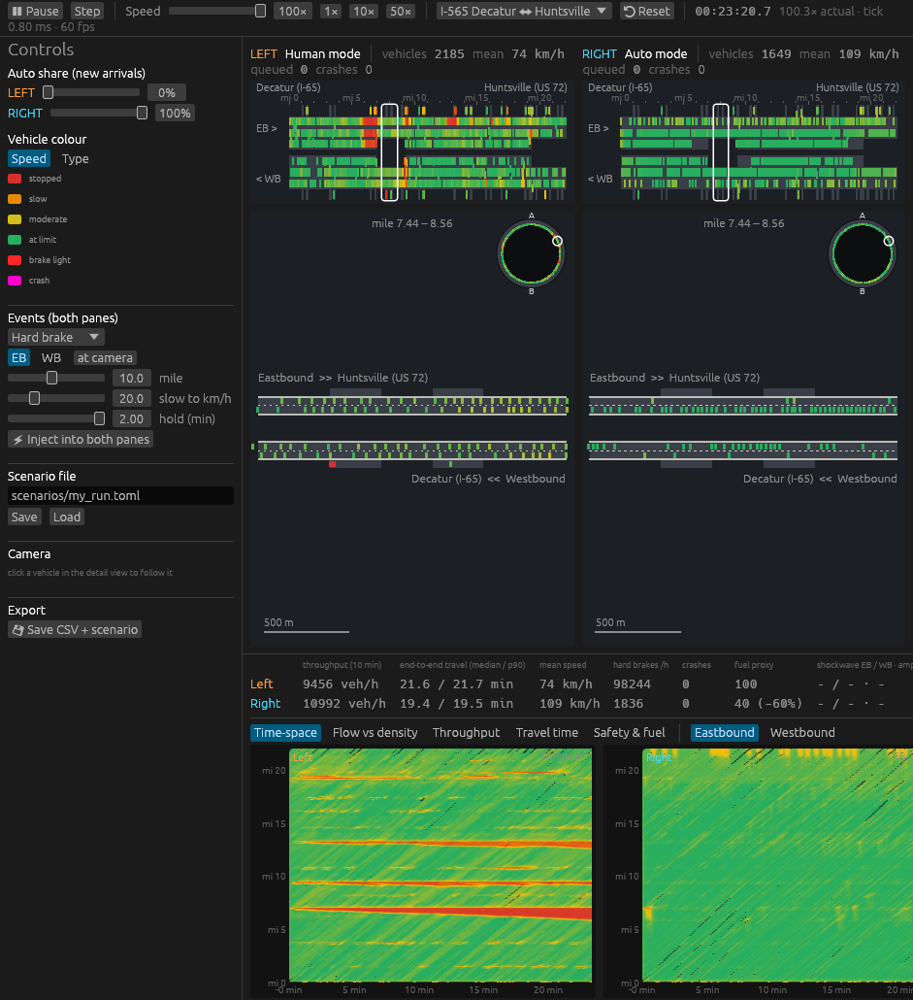

# Highway Traffic Simulator

A native Rust desktop app that simulates a highway between two cities in
both directions (closed into a ring through the end loops) and runs
**Human mode** and **Auto mode** side by side on identical inputs: same
seed, same arrivals, same driver traits, same events. The only difference
between the panes is the controller mix.

The default scenario mirrors **I-565 from I-65 at Decatur to US 72 in
Huntsville, Alabama**: real exits and mileposts, the 2-lane work zone
between County Line Rd and Wall-Triana, the 65 mph zone and 2-lane
section east of Memorial Parkway, and a morning peak toward Redstone
Arsenal and Research Park.



Design: [`docs/design.md`](docs/design.md) · implementation notes and
deviations: [`docs/notes.md`](docs/notes.md) · pinned dependencies:
[`docs/deps.md`](docs/deps.md)

## Build and run

Requires Rust 1.95+ (tested with 1.98) and a GPU driver for wgpu (Vulkan,
Metal or DirectX).

```sh
cargo run --release -p traffic-app          # the GUI (binary: traffic-sim)
./check.sh                                  # build + clippy -D warnings + all tests
```

GUI command-line options: `--scenario <index>` (bundled list order),
`--load <file.toml>`, `--speed <x>`, `--mile <m>`, `--zoom <half-width m>`.

## Using the app

- **Top bar:** play/pause, single step, playback speed (0.25× to 100×),
  scenario picker, reset, simulated clock and performance.
- **Left panel:** auto share per pane (affects new arrivals, so changes
  spread through the corridor), colour by speed or vehicle type, the
  **event panel** (hard brake, crash, lane closure, demand surge, weather,
  comms outage), scenario save/load, CSV export.
- **Panes:** the corridor strip (eastbound on top, the mile-0 end on the left;
  click or drag to move the camera) above a zoomable detail view (scroll
  to zoom, drag to pan, click a vehicle to follow it) with a ring minimap.
  Brake lights, turn signals, distracted drivers (purple dot), autos (cyan
  stripe; bright when linked by CACC), closures (orange), crashes
  (magenta), weather (blue) and comms outages (purple line) are drawn.
- **Bottom panel:** headline numbers per pane (throughput, travel time,
  speed, hard brakes, crashes, fuel proxy, shockwave speed, wave
  amplification), then tabs for time-space heatmaps, flow vs density,
  throughput, travel time, and safety and fuel.

Saving a scenario writes everything done during the run (injected events
and slider changes) so loading it replays the run exactly.

## Headless runs

```sh
cargo run --release -p traffic-batch -- run scenarios/rush_hour_incidents.toml --minutes 60
cargo run --release -p traffic-batch -- sweep scenarios/city_a_to_b.toml --minutes 90 --step 10
cargo run --release -p traffic-batch -- validate
```

`sweep` runs one world per auto share in parallel and writes one CSV row
each. I-565 morning peak (6:30 to 8:00, minutes 15 to 90):

| Autos | Throughput | End-to-end travel (median / p90) | Mean speed | Crashes | Fuel proxy |
| ---: | ---: | ---: | ---: | ---: | ---: |
| 0% | 9,752 veh/h | 25.1 / 40.2 min | 59 km/h | 3 | 114 |
| 25% | 9,624 veh/h | 23.5 / 40.2 min | 57 km/h | 0 | 114 |
| 50% | 10,079 veh/h | 23.8 / 37.4 min | 67 km/h | 0 | 94 |
| 75% | 10,975 veh/h | 20.8 / 22.3 min | 102 km/h | 0 | 80 |
| 100% | 10,938 veh/h | 19.4 / 20.0 min | 108 km/h | 0 | 39 |

## Auto mode: a hive mind

Autos share one state bus (positions, speeds, intents, closures) and act as
a coordinated fleet:

- **No discretionary lane changes.** No overtaking, no weaving. Each auto
  is assigned a lane when it enters: trucks keep to the lowest open lane,
  cars spread over the lanes above it, and cars about to exit keep right.
  It then changes lanes only to reach that lane, to exit, or to leave a
  lane that ends. The test suite verifies that autos make zero
  discretionary changes.
- **Early, coordinated merging.** Closures and lane drops are known up to
  2 km ahead, so autos re-plan their lanes and move out while gaps are
  plentiful. A merging auto lines up with the nearest gap; the auto
  behind it eases off to open the space (gently, firmly only near the
  lane end). After a one-lane crash on a three-lane road, no auto is in
  the closed lane within 500 m of it, and traffic passes at 97% of its
  desired speed.
- **CACC platoons** at 0.6 s gaps with feed-forward over the bus
  (string-stable), radar ACC when following a human or when the bus is
  down.

## Bundled scenarios

| File | What it shows |
| --- | --- |
| `i565_decatur_huntsville.toml` | I-565, Decatur (I-65) to Huntsville (US 72): real exits, lanes and limits |
| `city_a_to_b.toml` | A generic 20-mile corridor with interchanges at miles 7 and 13 |
| `rush_hour_incidents.toml` | Same, with a phantom-jam trigger, a two-lane crash, rain and a demand surge |
| `sugiyama_ring.toml` | 22 cars on a 230 m ring: a jam forms without a bottleneck and travels backward |
| `single_av_ring.toml` | Stern et al.: one auto on a 260 m ring dissolves the stop-and-go waves |

## Validation (all run by `cargo test --release`)

| Check | Result |
| --- | --- |
| Phantom jam (Sugiyama) | Forms with no bottleneck, travels backward |
| Human reaction delay | Response lags by exactly τ (0.8, 1.2, 2.0 s) |
| Human wave amplification at 35 veh/km/lane | 1.51 over 2 km (unstable) |
| Jam head (shockwave) speed | 13.8 km/h upstream (empirical 15 ± 5) |
| Auto string stability at 60 veh/km/lane | amplification 0.26 over 2 km |
| Single auto on a ring | speed spread 1.21 → 0.13 m/s |
| Comms outage with hard brakes | no collisions |
| 100% autos, heavy merging | 6,694 merges in an hour, no collisions |
| Determinism / split-view fairness / parallel = serial | bit-identical |
| Crash then clearing | eastbound throughput 3,858 → 2,952 → 4,386 veh/h |
| Save then load | replays the run bit for bit |
| Autos: discretionary lane changes | zero |
| Autos: one-lane crash ahead | closed lane empty 500 m before it; traffic at ≥ 97% of desired speed |

Each milestone has its own test file in `crates/traffic-core/tests/` and a
screenshot in `docs/progress/`.

I-565 sources: [Wikipedia exit list](https://en.wikipedia.org/wiki/Interstate_565),
[AARoads](https://www.aaroads.com/interstate-guide/i-565-al/),
[Madison widening (Madison Record)](https://www.themadisonrecord.com/2024/09/18/i-565-widening-project-in-madison-to-start).
Ramp volumes are estimates calibrated to roughly 70,000 vehicles/day
through Madison, not counts.

## Layout

```text
crates/traffic-core/    engine: no GUI, no files, no printing
crates/traffic-app/     eframe/egui GUI (binary traffic-sim)
crates/traffic-batch/   headless CLI: runs, sweeps, validation
scenarios/              TOML scenarios shared by the app and the CLI
docs/                   design, notes, pinned deps, progress screenshots
```
