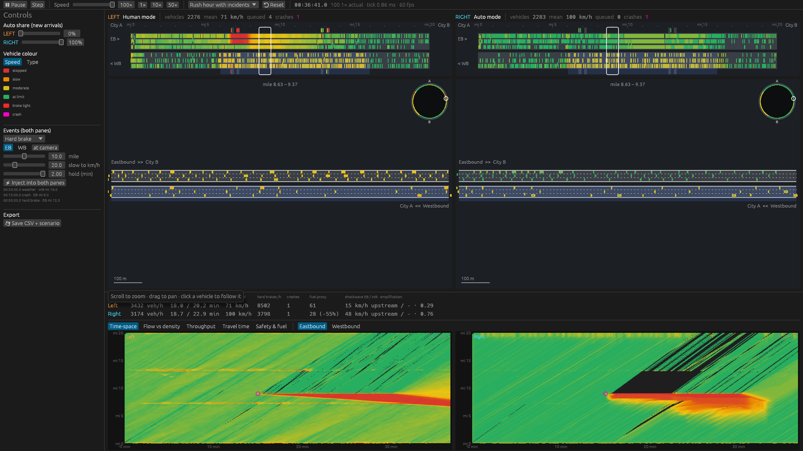

# Highway Traffic Simulator

A native Rust desktop app that simulates a 20-mile, 3-lane highway between
City A and City B (closed into a 40-mile ring) and runs **Human mode** and
**Auto mode** side by side on identical inputs: same seed, same arrivals,
same driver traits, same events. The only difference between the panes is
the controller mix.



Design: [`docs/design.md`](docs/design.md) · implementation notes and
deviations: [`docs/notes.md`](docs/notes.md) · pinned dependencies:
[`docs/deps.md`](docs/deps.md)

## Build and run

Requires Rust 1.95+ (tested with 1.98) and a GPU driver for wgpu (Vulkan,
Metal or DirectX).

```sh
cargo run --release -p traffic-app          # the GUI (binary: traffic-sim)
./check.sh                                  # build + clippy -D warnings + all tests
```

GUI command-line options: `--scenario <index>` (bundled list order),
`--load <file.toml>`, `--speed <x>`, `--mile <m>`, `--zoom <half-width m>`.

## Using the app

- **Top bar:** play/pause, single step, playback speed (0.25× to 100×),
  scenario picker, reset, simulated clock and performance.
- **Left panel:** auto share per pane (affects new arrivals, so changes
  spread through the corridor), colour by speed or vehicle type, the
  **event panel** (hard brake, crash, lane closure, demand surge, weather,
  comms outage), scenario save/load, CSV export.
- **Panes:** the corridor strip (eastbound on top, City A on the left;
  click or drag to move the camera) above a zoomable detail view (scroll
  to zoom, drag to pan, click a vehicle to follow it) with a ring minimap.
  Brake lights, turn signals, distracted drivers (purple dot), autos (cyan
  stripe; bright when linked by CACC), closures (orange), crashes
  (magenta), weather (blue) and comms outages (purple line) are drawn.
- **Bottom panel:** headline numbers per pane (throughput, travel time,
  speed, hard brakes, crashes, fuel proxy, shockwave speed, wave
  amplification), then tabs for time-space heatmaps, flow vs density,
  throughput, travel time, and safety and fuel.

Saving a scenario writes everything done during the run (injected events
and slider changes) so loading it replays the run exactly.

## Headless runs

```sh
cargo run --release -p traffic-batch -- run scenarios/rush_hour_incidents.toml --minutes 60
cargo run --release -p traffic-batch -- sweep scenarios/city_a_to_b.toml --minutes 90 --step 10
cargo run --release -p traffic-batch -- validate
```

`sweep` runs one world per auto share in parallel and writes one CSV row
each. On a 32-core machine, 11 runs × 90 simulated minutes take ~35 s.
Morning rush on the bundled corridor (minutes 15 to 90):

| Autos | Throughput | Travel A→B (median) | Mean speed | Hard brakes/h | Fuel proxy |
| ---: | ---: | ---: | ---: | ---: | ---: |
| 0% | 6,160 veh/h | 19.8 min | 91 km/h | 14,336 | 67 |
| 30% | 6,395 veh/h | 20.1 min | 95 km/h | 5,762 | 65 |
| 60% | 6,610 veh/h | 19.1 min | 101 km/h | 4,734 | 61 |
| 100% | 6,653 veh/h | 17.4 min | 108 km/h | 110 | 23 |

## Bundled scenarios

| File | What it shows |
| --- | --- |
| `city_a_to_b.toml` | The corridor with morning/evening peaks and interchanges at miles 7 and 13 |
| `rush_hour_incidents.toml` | Same, with a phantom-jam trigger, a two-lane crash, rain and a demand surge |
| `sugiyama_ring.toml` | 22 cars on a 230 m ring: a jam forms without a bottleneck and travels backward |
| `single_av_ring.toml` | Stern et al.: one auto on a 260 m ring dissolves the stop-and-go waves |

## Validation (all run by `cargo test --release`)

| Check | Result |
| --- | --- |
| Phantom jam (Sugiyama) | Forms with no bottleneck, travels backward |
| Human reaction delay | Response lags by exactly τ (0.8, 1.2, 2.0 s) |
| Human wave amplification at 35 veh/km/lane | 1.51 over 2 km (unstable) |
| Jam head (shockwave) speed | 13.8 km/h upstream (empirical 15 ± 5) |
| Auto string stability at 60 veh/km/lane | amplification 0.26 over 2 km |
| Single auto on a ring | speed spread 1.21 → 0.13 m/s |
| Comms outage with hard brakes | no collisions |
| 100% autos, heavy merging | 6,694 merges in an hour, no collisions |
| Determinism / split-view fairness / parallel = serial | bit-identical |
| Crash then clearing | eastbound throughput 3,858 → 2,952 → 4,386 veh/h |
| Save then load | replays the run bit for bit |

Each milestone has its own test file in `crates/traffic-core/tests/` and a
screenshot in `docs/progress/`.

## Layout

```text
crates/traffic-core/    engine: no GUI, no files, no printing
crates/traffic-app/     eframe/egui GUI (binary traffic-sim)
crates/traffic-batch/   headless CLI: runs, sweeps, validation
scenarios/              TOML scenarios shared by the app and the CLI
docs/                   design, notes, pinned deps, progress screenshots
```
